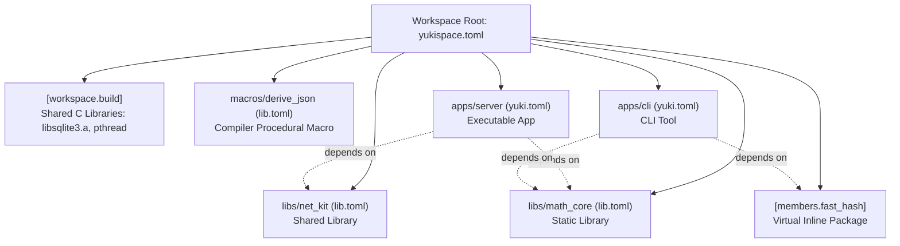

# Workspaces and Multi-Package Projects (yukispace.toml)

For managing monorepos, modular architectures, and coordinated development of multiple interrelated libraries and applications, Yukino provides a **universal workspace** mechanism (`Workspace`).

Unlike single isolated projects managed by a standalone `yuki.toml` or `lib.toml` file, a workspace groups multiple packages under the unified control of a root `yukispace.toml` manifest. This eliminates redundant configurations, simplifies native C library builds, and streamlines dependency management.

---

## Table of Contents

1. [Workspace Concepts: What They Are and Why They Exist](#1-workspace-concepts-what-they-are-and-why-they-exist)  
   1.1 [For Developers Coming from Languages Without Built-in Workspaces](#11-for-developers-coming-from-languages-without-built-in-workspaces)  
   1.2 [What Problems Workspaces Solve](#12-what-problems-workspaces-solve)  
   1.3 [Workspace Architecture](#13-workspace-architecture)  
2. [Creating and Structuring a Workspace](#2-creating-and-structuring-a-workspace)  
   2.1 [Command yukino new --workspace](#21-command-yukino-new---workspace)  
   2.2 [Adding Member Packages (--app, --static, --dynamic, --macro)](#22-adding-member-packages---app---static---dynamic---macro)  
3. [Full Configuration of the yukispace.toml Manifest](#3-full-configuration-of-the-yukispacetoml-manifest)  
   3.1 [[workspace] Section and Declaring Members](#31-workspace-section-and-declaring-members)  
   3.2 [Shared Native C Libraries: [workspace.build]](#32-shared-native-c-libraries-workspacebuild)  
   3.3 [Inline Virtual Packages: [members.<name>]](#33-inline-virtual-packages-membersname)  
4. [How the Package Manager Interacts with Workspaces](#4-how-the-package-manager-interacts-with-workspaces)  
   4.1 [Imports and Namespaces: Dependency Key Alias vs Member Package Name](#41-imports-and-namespaces-dependency-key-alias-vs-member-package-name)  
   4.2 [The package Selector (and Aliases sublib, subpath, lib)](#42-the-package-selector-and-aliases-sublib-subpath-lib)  
   4.3 [Internal Dependencies Between Workspace Members](#43-internal-dependencies-between-workspace-members)  
   4.4 [Resolving Workspaces from Repositories, Archives, and Local Paths](#44-resolving-workspaces-from-repositories-archives-and-local-paths)  
5. [Practical Usage Scenarios (What to Do in Each Case)](#5-practical-usage-scenarios-what-to-do-in-each-case)  
   5.1 [Scenario 1: Application with an Internal Shared Library](#51-scenario-1-application-with-an-internal-shared-library)  
   5.2 [Scenario 2: Multi-Package SDK in a Single Repository](#52-scenario-2-multi-package-sdk-in-a-single-repository)  
   5.3 [Scenario 3: Procedural Macro Inside a Workspace](#53-scenario-3-procedural-macro-inside-a-workspace)  
   5.4 [Scenario 4: Shared Native C Library for All Workspace Members](#54-scenario-4-shared-native-c-library-for-all-workspace-members)  
   5.5 [Scenario 5: Lightweight Inline Module Without a Separate lib.toml](#55-scenario-5-lightweight-inline-module-without-a-separate-libtoml)  
6. [Building, Testing, and Running Inside a Workspace](#6-building-testing-and-running-inside-a-workspace)  
   6.1 [Building All Packages: yukino build](#61-building-all-packages-yukino-build)  
   6.2 [Targeting a Specific Package: Flag -p / --package](#62-targeting-a-specific-package-flag--p----package)  
   6.3 [Testing All or Specific Packages: yukino test](#63-testing-all-or-specific-packages-yukino-test)  
   6.4 [Running Executable Applications: yukino run](#64-running-executable-applications-yukino-run)  
   6.5 [Feature Management: --features, --all-features, --no-default-features](#65-feature-management---features---all-features---no-default-features)  
7. [Common Pitfalls and Best Practices](#7-common-pitfalls-and-best-practices)

---

## 1. Workspace Concepts: What They Are and Why They Exist

### 1.1 For Developers Coming from Languages Without Built-in Workspaces

If you are coming from classic C or C++ (where builds are orchestrated via custom Makefiles or CMakeLists.txt) or from Python (where projects often reside in isolated repositories and rely on manual virtual environment path juggling), the concept of a workspace might be unfamiliar.

In the traditional multi-repository approach:
- Each library lives in its own standalone Git repository.
- To test a change made in library `core`, you must compile it, tag or publish a new version, or manually copy the binary artifact into the directory of application `app`.
- If your project has 5 related libraries, developers must make 5 separate commits across 5 repositories and manually synchronize version numbers.
- If libraries share low-level C code (such as SQLite or OpenSSL), that C code is compiled redundantly in each separate project, wasting disk space and CPU time.

A **Workspace** solves these problems by organizing a **monorepo**:
- All related packages (libraries, CLI tools, services, compiler procedural macros) live together in a single repository.
- When you edit a library, all applications that depend on it see the changes immediately without any publishing step.
- A single `yukispace.toml` file at the root coordinates building and testing all members.
- Native C dependencies are compiled once at the workspace level and automatically shared across all member projects.

### 1.2 What Problems Workspaces Solve

1. **Atomic Code Changes**: Modifying a library's public API and updating all consumer applications occurs within a single build invocation and a single Git commit.
2. **Zero Redundancy for C Dependencies**: If three libraries in a workspace require `pthread` or a static archive `libsqlite3.a`, declaring them once in `yukispace.toml` links them across all members.
3. **Ergonomic Dependency Selection**: External projects can depend on your single Git repository or workspace path, selectively pulling individual member libraries using `package = "member_name"`.
4. **Unified Build Cache**: Shared build artifacts allow object files and archives to be reused between unit tests and executable binaries.

### 1.3 Workspace Architecture



---

## 2. Creating and Structuring a Workspace

### 2.1 Command yukino new --workspace

To initialize a new workspace, pass the `--workspace` flag to `yukino new`:

```sh
yukino new my_workspace --workspace
```

This generates the following directory layout:

```text
my_workspace/
├── yukispace.toml    # Root workspace manifest
├── libs/             # Directory for library member packages
└── apps/             # Directory for application member packages
```

The initial `yukispace.toml` is pre-populated with:

```toml
[workspace]
members = [
    "libs/*",
    "apps/*",
]
```

### 2.2 Adding Member Packages (--app, --static, --dynamic, --macro)

Inside the workspace directory, member packages of various kinds can be created using standard `yukino new` subcommands:

```sh
cd my_workspace

# 1. Create a static library for business logic:
yukino new libs/core_lib --static

# 2. Create a dynamic (shared) library for plugins:
yukino new libs/plugin_api --dynamic

# 3. Create a compiler procedural macro:
yukino new libs/json_macro --macro

# 4. Create an executable CLI application:
yukino new apps/my_cli --app
```

Each member receives its own manifest:
- `yuki.toml` for executable applications (`--app`).
- `lib.toml` for static libraries, shared libraries, and procedural macros (`--static`, `--dynamic`, `--macro`).

Because `yukispace.toml` defines wildcard patterns `"libs/*"` and `"apps/*"`, the compiler automatically discovers all member packages.

---

## 3. Full Configuration of the yukispace.toml Manifest

### 3.1 [workspace] Section and Declaring Members

The `[workspace]` table declares workspace metadata and member discovery paths:

```toml
[workspace]
name = "my_workspace"
members = [
    "libs/*",
    "apps/*",
    "tools/profiler",
]
default_members = [
    "apps/my_cli",
]
```

Fields in `[workspace]`:
- `name` *(string, optional)*: A human-readable workspace identifier.
- `members` *(list of strings, required)*: Directory paths or glob patterns (`"libs/*"`) pointing to member package directories. Each member directory must contain `yuki.toml` or `lib.toml`.
- `default_members` *(list of strings, optional)*: Specific member packages built when running `yukino build` without a `-p` flag. If omitted, all packages discovered in `members` are built.

### 3.2 Shared Native C Libraries: [workspace.build]

When several workspace members require the same system libraries, native `.o` objects, or precompiled `.a` archives, declare them centrally in `[workspace.build]` (or top-level `[build]`):

```toml
[workspace.build]
archives = [
    "vendor/c/libsqlite3.a",
]
objects = [
    "native/crc32.o",
]
search_paths = [
    "vendor/c/lib",
]
system = [
    "pthread",
    "dl",
    "m",
]
```

Fields in `[workspace.build]`:
- `archives`: Static `.a` archives linked with all members. Paths are resolved relative to the workspace root.
- `objects`: Precompiled `.o` object files.
- `search_paths`: Additional directory search paths passed to the system linker.
- `system`: Operating system libraries (e.g., `pthread`, `dl`, `m`, `ws2_32`).

These settings are automatically forwarded to `yukic` during linking for each workspace member.

### 3.3 Inline Virtual Packages: [members.<name>]

For small modules containing only a few functions where creating an entire subfolder with a separate `lib.toml` is unnecessary overhead, Yukino provides **virtual inline packages** declared directly in `yukispace.toml`:

```toml
[members.fast_hash]
kind = "static"
entry = "common/fast_hash.ykn"
version = "0.1.0"
includes = ["stdlib"]
archives = ["native/libmurmur.a"]
system = ["m"]

[members.fast_hash.features]
default = []
sse4 = []
```

Fields in an inline package:
- `kind` (or `output`, `type`): Artifact kind. Supported values are `"static"` (static library), `"shared"` (dynamic library), or `"macro"` (compiler procedural macro). Defaults to `"static"`.
- `entry`: Relative path from the workspace root to the entry `.ykn` file.
- `version` *(optional)*: Version string.
- `includes` *(optional)*: Built-in namespaces to include (defaults to `["stdlib"]`).
- `archives`, `objects`, `search_paths`, `system`: Low-level dependencies specific to this inline module.
- `features`: Feature flags for this inline package.

Inline packages participate in the build system as full members: they can be built individually via `yukino build -p fast_hash` and consumed by other packages via `package = "fast_hash"`.

---

## 4. How the Package Manager Interacts with Workspaces

### 4.1 Imports and Namespaces: Dependency Key Alias vs Member Package Name

When importing workspace members and external libraries in Yukino code, developers often ask:
**Which name is used in Yukino source code with the load keyword?**

**Answer:** Code imports ALWAYS use the dependency key alias declared under `[libs.runtime]` in your project manifest, NOT the internal member package name.

Understanding this distinction:
- `[libs.runtime.<namespace_key>]` defines the local identifier under which the compiler exposes the library namespace to your source code (`load <namespace_key>`).
- The `package = "<member_name>"` field is strictly a package manager locator used during resolution to select which package to build from the target workspace or repository.

#### Example 1: Matching Names

In your application manifest `apps/my_cli/yuki.toml`:

```toml
[libs.runtime.math_core]
path = "../../my_workspace"
package = "math_core"
```

In your application source code `apps/my_cli/src/main.ykn`:

```yukino
load math_core: solve_quadratic, Vector3
load math_core.geometry: Circle

fun main() {
    set c = Circle { radius: 10.0 }
    println("circle radius: ${c.radius}")
}
```

#### Example 2: Resolving Naming Conflicts Using Aliases

Suppose you pull two third-party workspaces from Git, and both happen to have an internal member named `utils`.

If imports relied on the internal package name, an unresolvable collision would occur. With Yukino, you assign custom aliases in your manifest:

```toml
[libs.runtime.engine_utils]
path = "../vendor/game_engine"
package = "utils"

[libs.runtime.net_utils]
path = "../vendor/network_stack"
package = "utils"
```

In your Yukino code, each package has a completely isolated namespace:

```yukino
load engine_utils: MathHelper
load net_utils: SocketHelper

fun main() {
    set m = MathHelper.new()
    set s = SocketHelper.new()
}
```

### 4.2 The package Selector (and Aliases sublib, subpath, lib)

The `package` field designates which member package of a target workspace to build. The `yukino` package manager supports several interchangeable aliases for this field:

```toml
# Standard form
[libs.runtime.my_lib1]
path = "../some_workspace"
package = "core"

# sublib alias
[libs.runtime.my_lib2]
path = "../some_workspace"
sublib = "crypto"

# lib alias
[libs.runtime.my_lib3]
path = "../some_workspace"
lib = "net"

# subpath alias
[libs.runtime.my_lib4]
path = "../some_workspace"
subpath = "compress"
```

All four forms behave identically:
1. The package manager reads `yukispace.toml` in the target directory `path`.
2. Matches the member by name among `members` or inline virtual packages `[members.<name>]`.
3. Builds the requested artifact and attaches its search paths and compiled archive to your project.

### 4.3 Internal Dependencies Between Workspace Members

Members residing in the same workspace reference one another using relative paths:

```toml
# In apps/my_cli/yuki.toml:
[package]
name = "my_cli"
type = "app"
entry = "src/main.ykn"

[libs.runtime.core]
path = "../../libs/core_lib"

[libs.runtime.hash]
path = "../../"
package = "fast_hash" # References an inline workspace package
```

In source code `apps/my_cli/src/main.ykn`:

```yukino
load core: process_data
load hash: murmur_hash64

fun main() {
    set h = murmur_hash64("hello")
    process_data(h)
}
```

### 4.4 Resolving Workspaces from Repositories, Archives, and Local Paths

The `yukino` package manager supports consuming external multi-package workspaces from all supported dependency sources: remote Git repositories, network archives, and local filesystem directories.

When an external repository or archive contains a `yukispace.toml` manifest in its root, the package manager identifies it as a workspace and uses the `package` specifier (or its aliases `sublib`, `subpath`, `lib`) to select and build exactly the package required by your project.

#### 1. Local Workspaces via path

Used for linking projects locally on the same development workstation:

```toml
[libs.runtime.crypto]
path = "../vendor/monorepo_toolkit"
package = "crypto_lib"
```

Resolution workflow:
1. The package manager resolves `../vendor/monorepo_toolkit` relative to your project's manifest directory.
2. It detects the root `yukispace.toml` file.
3. It scans workspace members and compiles the `crypto_lib` package.

#### 2. Remote Git Repositories via git

Allows pulling specific libraries from large multi-package Git monorepositories without manually cloning or managing them inside your project tree:

```toml
# Tracking the main branch
[libs.runtime.render_engine]
git = "https://github.com/company/game_suite.git"
branch = "main"
package = "render_core"

# Pinned to a specific release tag
[libs.runtime.net_protocol]
git = "https://github.com/company/game_suite.git"
tag = "v2.1.0"
package = "net_driver"

# Pinned to an exact commit hash
[libs.runtime.physics]
git = "https://github.com/company/game_suite.git"
rev = "8f3e2a1b9c"
package = "physics2d"
```

Resolution workflow:
1. The repository is cloned into the local dependency cache (`yuki-work/local/deps/git/<name>`).
2. If `tag`, `branch`, or `rev` is specified, `git checkout` is executed on that revision.
3. The root of the checked-out tree is inspected for `yukispace.toml`.
4. The exact commit hash and tree state are recorded in `yuki.lock`.
5. The package manager locates the member matching `package` and compiles it.

#### 3. Remote Compressed Archives via link

Supports direct download of compressed workspace archives over HTTP/HTTPS:

```toml
[libs.runtime.gui_widgets]
link = "https://cdn.example.com/releases/desktop_kit-1.4.0.tar.zst"
sha256 = "e3b0c44298fc1c149afbf4c8996fb92427ae41e4649b934ca495991b7852b855"
package = "widgets"
```

Supported archive formats:
- `.tar.gz` (`.tgz`)
- `.tar.xz` (`.txz`)
- `.tar.zst` (`.zst`)
- `.zip`

Extraction and single-folder wrapper stripping:
1. The archive is downloaded and verified against the expected `sha256` checksum (if specified).
2. The archive is unpacked into the dependency cache directory.
3. If all extracted files reside inside a single top-level directory (standard for GitHub/GitLab release tarballs such as `desktop_kit-1.4.0/...`), the package manager automatically flattens that single folder, bringing `yukispace.toml`, `lib.toml`, or `yuki.toml` directly to the root of the dependency folder.
4. `yukispace.toml` is identified in the root directory.
5. The member matching the `package` specifier is located and compiled.

#### 4. Member Lookup Algorithm Inside a Workspace

Once a workspace is available (via `path`, `git`, or `link`), looking up the requested package name proceeds in order:

1. **Inline Virtual Packages**: The package manager first checks the `[members.<name>]` table in `yukispace.toml`. If found, a project manifest is synthesized directly from the workspace manifest.
2. **Directory Members**: If no inline member matches, the manager iterates over all directories declared in `workspace.members` (including glob wildcards such as `libs/*` or `plugins/*`).
3. **Manifest Identification**: In each member directory, `lib.toml` (or `yuki.toml`) is loaded. A member matches if the library name in `[lib]` (or `[bin]`) equals the requested package name, or if the directory basename matches the requested name.
4. **Inheriting Workspace Build Settings**: C archives and link flags declared under `[workspace.build]` in the root `yukispace.toml` are automatically inherited and applied during member compilation.

---

## 5. Practical Usage Scenarios (What to Do in Each Case)

### 5.1 Scenario 1: Application with an Internal Shared Library

**Goal**: You are building a desktop or CLI application and want to separate heavy business logic into a dedicated static library for clean modularity and isolated testing.

**Step-by-step**:
1. Initialize the workspace:
   ```sh
   yukino new project_suite --workspace
   cd project_suite
   ```
2. Create the static library:
   ```sh
   yukino new libs/engine --static
   ```
3. Create the executable application:
   ```sh
   yukino new apps/desktop_app --app
   ```
4. Reference the library in `apps/desktop_app/yuki.toml`:
   ```toml
   [libs.runtime.engine]
   path = "../../libs/engine"
   ```
5. Use the library in `apps/desktop_app/src/main.ykn`:
   ```yukino
   load engine: EngineConfig, start_engine

   fun main() {
       set cfg = EngineConfig { max_threads: 4 }
       start_engine(cfg)
   }
   ```
6. Build both projects simultaneously from the workspace root:
   ```sh
   yukino build
   ```
7. Run the application:
   ```sh
   yukino run -p desktop_app
   ```

### 5.2 Scenario 2: Multi-Package SDK in a Single Repository

**Goal**: You are publishing an open-source SDK for a cloud platform consisting of three packages: core types (`sdk-core`), HTTP transport (`sdk-http`), and token authentication (`sdk-auth`).

**Repository Layout**:
```text
cloud_sdk/
├── yukispace.toml
└── libs/
    ├── core/       # lib.toml (name = "core")
    ├── http/       # lib.toml (name = "http")
    └── auth/       # lib.toml (name = "auth")
```

Content of `cloud_sdk/yukispace.toml`:
```toml
[workspace]
name = "cloud_sdk"
members = ["libs/*"]
```

External consumers pulling your repository via Git can selectively consume only what they need:

```toml
# In consumer yuki.toml:
[libs.runtime.cloud_auth]
git = "https://github.com/example/cloud_sdk"
package = "auth"

[libs.runtime.cloud_http]
git = "https://github.com/example/cloud_sdk"
package = "http"
```

In consumer source code:
```yukino
load cloud_auth: authenticate_token
load cloud_http: Client
```

### 5.3 Scenario 3: Procedural Macro Inside a Workspace

**Goal**: You want to develop a compile-time procedural macro (e.g., struct serialization code generator) alongside your application.

**Step-by-step**:
1. Create the macro package using the `--macro` flag:
   ```sh
   yukino new libs/validate_macro --macro
   ```
   The generated `libs/validate_macro/lib.toml` automatically sets `output = "macro"`.
2. Declare the macro under `[libs.macro]` in `apps/desktop_app/yuki.toml`:
   ```toml
   [libs.macro.validate]
   path = "../../libs/validate_macro"
   ```
3. The build system compiles the macro runner binary for the host machine architecture and attaches it during the build process.

### 5.4 Scenario 4: Shared Native C Library for All Workspace Members

**Goal**: Multiple microservices and tools within your workspace interact with a local SQLite database via C FFI (`externc`). You want to avoid duplicating `libsqlite3.a` and `pthread` linkage settings across every package manifest.

**Solution**:
Place the compiled C archive in `vendor/c/` at the workspace root and register it in `yukispace.toml`:

```toml
[workspace]
members = ["apps/*", "libs/*"]

[workspace.build]
archives = [
    "vendor/c/libsqlite3.a",
]
system = [
    "pthread",
    "dl",
]
```

Any member package can now invoke SQLite C functions directly without repeating linker flags:

```yukino
externc {
    fun sqlite3_open(filename: ptr<int8>, db_ptr: ptr<ptr<void>>): int32
    fun sqlite3_close(db_ptr: ptr<void>): int32
}
```

Running `yukino build` links all applications with `libsqlite3.a`, `libpthread`, and `libdl` automatically.

### 5.5 Scenario 5: Lightweight Inline Module Without a Separate lib.toml

**Goal**: You want to extract a shared helper (e.g., base64 encoding) into an isolated module without creating nested directory trees and a separate `lib.toml`.

**Solution**:
Place the implementation in `shared/base64.ykn` and register it in `yukispace.toml`:

```toml
[workspace]
members = ["apps/*"]

[members.base64]
kind = "static"
entry = "shared/base64.ykn"
```

Any workspace member can now reference it:

```toml
# In apps/my_cli/yuki.toml:
[libs.runtime.b64]
path = "../../"
package = "base64"
```

And import it in Yukino code:

```yukino
load b64: encode_base64

fun main() {
    set s = encode_base64("hello world")
    println(s)
}
```

---

## 6. Building, Testing, and Running Inside a Workspace

When executed within a workspace root (the directory containing `yukispace.toml`), the CLI tools automatically operate in multi-package mode.

### 6.1 Building All Packages: yukino build

```sh
# Build all workspace members in debug mode:
yukino build

# Build all workspace members in release mode:
yukino build release
```

If `default_members` is declared in `yukispace.toml`, only those designated members are built. Otherwise, every detected package in `members` is built.

### 6.2 Targeting a Specific Package: Flag -p / --package

To compile an individual member package:

```sh
# Build only the static library core_lib:
yukino build -p core_lib

# Build only the executable my_cli in release mode:
yukino build release -p my_cli
```

### 6.3 Testing All or Specific Packages: yukino test

The `yukino test` command runs unit tests across workspace members:

```sh
# Run tests across all workspace packages:
yukino test

# Run tests only for core_lib:
yukino test -p core_lib
```

### 6.4 Running Executable Applications: yukino run

The `yukino run` command compiles and runs the chosen executable application:

```sh
# Run application my_cli with arguments:
yukino run -p my_cli -- --input test.txt --verbose
```

### 6.5 Feature Management: --features, --all-features, --no-default-features

Feature flags apply uniformly across all compiled workspace packages:

```sh
# Enable specific feature flags:
yukino build -p my_cli --features fast_math,simd

# Enable all features declared across members:
yukino test -p core_lib --all-features

# Disable default features:
yukino build -p my_cli --no-default-features
```

---

## 7. Common Pitfalls and Best Practices

1. **Avoid Circular Dependencies**:
   If package `A` depends on package `B`, package `B` must not depend on package `A`. When circular relationships arise, extract the shared types or interfaces into a common base package `common_types`.

2. **Do Not Conflate Code Namespace with Package Name**:
   Remember: `load foo` in your Yukino code always references the key alias `foo` defined in your manifest `[libs.runtime]`. The `package = "bar"` selector tells the builder which package to compile from the target repository.

3. **Separate Global and Local Native C Dependencies**:
   Place in `[workspace.build]` only C libraries that are universally needed by the majority of members (such as runtime components, threading libraries, or standard databases). If a C library is only used by one package, declare it in that package's local `lib.toml`.

4. **Commit yuki.lock for Reproducibility**:
   The `yuki.lock` file is generated at the workspace root, preserving exact versions, package hashes, and resolved dependencies across development environments.

---

[← Previous: Error Handling and Exceptions](14-errors.md) | [Next: Testing and Test Runner →](16-tests.md)
