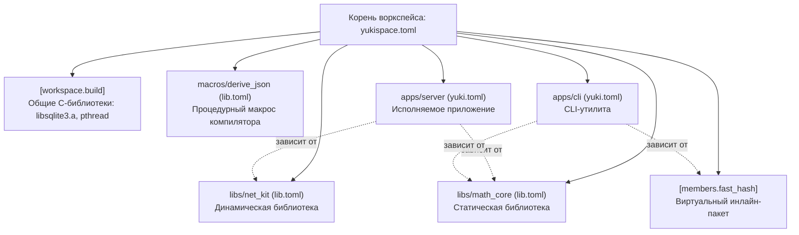

# Воркспейсы и многопакетные проекты (yukispace.toml)

Для организации монорепозиториев, модульных архитектур и скоординированной разработки нескольких связанных библиотек и приложений Yukino предоставляет механизм универсальных воркспейсов (`Workspace`).

В отличие от одиночных изолированных проектов с файлом `yuki.toml` или `lib.toml`, воркспейс объединяет группу пакетов под единым управлением корневого манифеста `yukispace.toml`. Это устраняет дублирование настроек, решает проблему сборки общих C-библиотек и упрощает работу менеджера зависимостей.

---

## Оглавление

1. [Концепция воркспейсов: что это и зачем они нужны](#1-концепция-воркспейсов-что-это-и-зачем-они-нужны)
   1.1 [Для разработчиков из языков без встроенных воркспейсов](#11-для-разработчиков-из-языков-без-встроенных-воркспейсов)
   1.2 [Какие проблемы решает воркспейс](#12-какие-проблемы-решает-воркспейс)
   1.3 [Архитектура воркспейса](#13-архитектура-воркспейса)
2. [Создание и структура воркспейса](#2-создание-и-структура-воркспейса)
   2.1 [Команда yukino new --workspace](#21-команда-yukino-new---workspace)
   2.2 [Добавление пакетов разных типов (--app, --static, --dynamic, --macro)](#22-добавление-пакетов-разных-типов---app---static---dynamic---macro)
3. [Полная конфигурация манифеста yukispace.toml](#3-полная-конфигурация-манифеста-yukispacetoml)
   3.1 [Секция [workspace] и указание участников (members)](#31-секция-workspace-и-указание-участников-members)
   3.2 [Общие C-библиотеки и сборка: [workspace.build]](#32-общие-c-библиотеки-и-сборка-workspacebuild)
   3.3 [Инлайн-пакеты (виртуальные участники): [members.<name>]](#33-инлайн-пакеты-виртуальные-участники-membersname)
4. [Как менеджер пакетов работает с воркспейсами](#4-как-менеджер-пакетов-работает-с-воркспейсами)
   4.1 [Импорты и неймспейсы: имя алиаса против имени участника пакета](#41-импорты-и-неймспейсы-имя-алиаса-против-имени-участника-пакета)
   4.2 [Селектор package (а также sublib, subpath, lib)](#42-селектор-package-а-также-sublib-subpath-lib)
   4.3 [Внутренние зависимости между участниками воркспейса](#43-внутренние-зависимости-между-участниками-воркспейса)
   4.4 [Разрешение воркспейсов из репозиториев, архивов и каталогов](#44-разрешение-воркспейсов-из-репозиториев-архивов-и-каталогов)
5. [Практические сценарии использования (Что делать в каком случае)](#5-практические-сценарии-использования-что-делать-в-каком-случае)
   5.1 [Сценарий 1: Приложение с внутренней общей библиотекой](#51-сценарий-1-приложение-с-внутренней-общей-библиотекой)
   5.2 [Сценарий 2: Многопакетный SDK в одном репозитории](#52-сценарий-2-многопакетный-sdk-в-оном-репозитории)
   5.3 [Сценарий 3: Процедурный макрос внутри воркспейса](#53-сценарий-3-процедурный-макрос-внутри-воркспейса)
   5.4 [Сценарий 4: Общая C-библиотека для всех участников воркспейса](#54-сценарий-4-общая-c-библиотека-для-всех-участников-воркспейса)
   5.5 [Сценарий 5: Легковесный инлайн-модуль без создания lib.toml](#55-сценарий-5-легковесный-инлайн-модуль-без-создания-libtoml)
6. [Команды сборки, тестирования и запуска в воркспейсе](#6-команды-сборки-тестирования-и-запуска-в-воркспейсе)
   6.1 [Сборка всех пакетов: yukino build](#61-сборка-всех-пакетов-yukino-build)
   6.2 [Выбор пакета флагом -p / --package](#62-выбор-пакета-флагом--p----package)
   6.3 [Тестирование всех или выбранных пакетов: yukino test](#63-тестирование-всех-или-выбранных-пакетов-yukino-test)
   6.4 [Запуск исполняемых пакетов: yukino run](#64-запуск-исполняемых-пакетов-yukino-run)
   6.5 [Управление фичами: --features, --all-features, --no-default-features](#65-управление-фичами---features---all-features---no-default-features)
7. [Типичные ошибки и рекомендации](#7-типичные-ошибки-и-рекомендации)

---

## 1. Концепция воркспейсов: что это и зачем они нужны

### 1.1 Для разработчиков из языков без встроенных воркспейсов

Если вы пришли из классического C или C++, где сборка настраивалась вручную скриптами Makefile или файлами CMakeLists.txt, либо из Python, где проекты часто лежат в изолированных репозиториях или объединяются через виртуальные окружения, концепция воркспейса может быть новой.

В традиционном подходе с отдельными репозиториями:
- Каждая библиотека лежит в своем Git-репозитории.
- Чтобы протестировать изменение в библиотеке `core`, нужно обновить ее код, собрать артефакт, выпустить новую версию или скопировать бинарник в папку приложения `app`.
- Если в проекте 5 связанных библиотек, разработчику приходится делать 5 отдельных коммитов в разные репозитории и синхронизировать номера версий.
- Если библиотекам нужен общий C-код (например, SQLite или OpenSSL), этот C-код собирается заново в каждом проекте, тратя время процессора и диск.

Воркспейс (Workspace) решает эту проблему, организуя **монорепозиторий**:
- Все связанные пакеты (библиотеки, CLI-утилиты, веб-сервисы, процедурные макросы) хранятся в одном репозитории.
- При изменении библиотеки все зависящие от нее приложения видят эти изменения мгновенно, без перевыпуска версий.
- Единый файл `yukispace.toml` в корне управляет сборкой всех проектов разом.
- Низкоуровневые C-зависимости компилируются один раз на уровне воркспейса и автоматически разделяются между всеми участниками.

### 1.2 Какие проблемы решает воркспейс

1. **Атомарные изменения кода**: изменение публичного API библиотеки и обновление всех приложений, использующих это API, происходят в рамках одной сборки и одного коммита.
2. **Отсутствие дублирования C-библиотек**: если трем библиотекам воркспейса требуется системная библиотека `pthread` или архив `libsqlite3.a`, достаточно указать их один раз в корневом манифесте `yukispace.toml`.
3. **Удобство для внешних потребителей**: сторонний проект может подключить один репозиторий воркспейса через Git или относительный путь, а затем выбрать нужный пакет через селектор `package = "имя"`.
4. **Унифицированный кэш сборки**: единая папка сборки артефактов позволяет переиспользовать объектные файлы между тестами и бинарниками.

### 1.3 Архитектура воркспейса



---

## 2. Создание и структура воркспейса

### 2.1 Команда yukino new --workspace

Для инициализации нового воркспейса выполните команду с флагом `--workspace`:

```sh
yukino new my_workspace --workspace
```

Будет создана следующая файловая структура:

```text
my_workspace/
├── yukispace.toml    # Корневой манифест воркспейса
├── libs/             # Каталог для библиотек-участников
└── apps/             # Каталог для приложений-участников
```

Файл `yukispace.toml` создается со стандартным содержимым:

```toml
[workspace]
members = [
    "libs/*",
    "apps/*",
]
```

### 2.2 Добавление пакетов разных типов (--app, --static, --dynamic, --macro)

Внутри каталогов воркспейса вы можете создавать дочерние проекты стандартной командой `yukino new`:

```sh
cd my_workspace

# 1. Создание статической библиотеки для бизнес-логики:
yukino new libs/core_lib --static

# 2. Создание динамической (shared) библиотеки для плагинов:
yukino new libs/plugin_api --dynamic

# 3. Создание процедурного макроса компилятора:
yukino new libs/json_macro --macro

# 4. Создание исполняемого приложения (CLI):
yukino new apps/my_cli --app
```

Каждый созданный проект получает собственный манифест:
- `yuki.toml` для исполняемых приложений (`--app`).
- `lib.toml` для статических, динамических библиотек и процедурных макросов (`--static`, `--dynamic`, `--macro`).

Поскольку в `yukispace.toml` указаны шаблоны `"libs/*"` и `"apps/*"`, компилятор автоматически находит все созданные проекты.

---

## 3. Полная конфигурация манифеста yukispace.toml

### 3.1 Секция [workspace] и указание участников (members)

Секция `[workspace]` определяет состав участников и параметры сборки по умолчанию:

```toml
[workspace]
name = "my_workspace"
members = [
    "libs/*",
    "apps/*",
    "tools/profiler",
]
default_members = [
    "apps/my_cli",
]
```

Поля секции `[workspace]`:
- `name` *(строка, опционально)*: произвольное имя воркспейса.
- `members` *(список строк, обязательно)*: список путей или glob-шаблонов (`"libs/*"`), указывающих на каталоги участников. Каждый каталог участника должен содержать `yuki.toml` или `lib.toml`.
- `default_members` *(список строк, опционально)*: список участников, которые компилируются по умолчанию при запуске `yukino build` без флага `-p`. Если поле не указано, собираются абсолютно все участники из `members`.

### 3.2 Общие C-библиотеки и сборка: [workspace.build]

Если нескольким участникам воркспейса требуются общие платформенные библиотеки, объектные C-файлы или статические архивы, их можно централизованно объявить в секции `[workspace.build]` (или `[build]`):

```toml
[workspace.build]
archives = [
    "vendor/c/libsqlite3.a",
]
objects = [
    "native/crc32.o",
]
search_paths = [
    "vendor/c/lib",
]
system = [
    "pthread",
    "dl",
    "m",
]
```

Поля секции `[workspace.build]`:
- `archives`: статические `.a` архивы, линкуемые со всеми участниками. Пути разрешаются относительно корня воркспейса.
- `objects`: скомпилированные `.o` объектные файлы.
- `search_paths`: дополнительные каталоги поиска библиотек для системного линкера.
- `system`: системные библиотеки ОС (например, `pthread`, `dl`, `m`, `ws2_32`).

Все настройки из этой секции автоматически передаются компилятору `yukic` при линковке каждого участника воркспейса.

### 3.3 Инлайн-пакеты (виртуальные участники): [members.<name>]

Иногда в проекте есть небольшой модуль из нескольких функций, для которого не хочется создавать отдельную папку и отдельный файл `lib.toml`. Для таких случаев предусмотрены **виртуальные инлайн-пакеты**, объявляемые прямо в `yukispace.toml`:

```toml
[members.fast_hash]
kind = "static"
entry = "common/fast_hash.ykn"
version = "0.1.0"
includes = ["stdlib"]
archives = ["native/libmurmur.a"]
system = ["m"]

[members.fast_hash.features]
default = []
sse4 = []
```

Поля инлайн-пакета:
- `kind` (или `output`, `type`): тип артефакта. Допустимые значения: `"static"` (статическая библиотека), `"shared"` (динамическая библиотека), `"macro"` (процедурный макрос). По умолчанию `"static"`.
- `entry`: путь к исходному файлу точки входа (`.ykn`), относительно корня воркспейса.
- `version` *(опционально)*: строка версии.
- `includes` *(опционально)*: список встроенных модулей (по умолчанию `["stdlib"]`).
- `archives`, `objects`, `search_paths`, `system`: специфичные низкоуровневые зависимости данного инлайн-модуля.
- `features`: словарь фич инлайн-пакета.

Инлайн-пакет полноценно участвует в сборке, может собираться через `yukino build -p fast_hash` и подключаться другими проектами через селектор `package = "fast_hash"`.

---

## 4. Как менеджер пакетов работает с воркспейсами

### 4.1 Импорты и неймспейсы: имя алиаса против имени участника пакета

При подключении внешних библиотек и участников воркспейса часто возникает вопрос:
**Через какое имя обращаться к модулям в коде на Yukino через ключевое слово load?**

**Ответ:** Обращение в коде ВСЕГДА происходит через имя ключа (алиаса), объявленного в секции `[libs.runtime]` вашего манифеста, а НЕ через имя участника пакета.

Разберем это детально:
- `[libs.runtime.<имя_неймспейса>]` определяет локальное имя в вашем проекте, под которым компилятор зарегистрирует библиотеку в пространстве имен (`load <имя_неймспейса>`).
- Поле `package = "<имя_участника>"` используется менеджером пакетов исключительно на этапе разрешения зависимостей, чтобы найти нужную библиотеку внутри репозитория или воркспейса и скомпилировать ее.

#### Пример 1: Совпадающие имена

Манифест вашего приложения `apps/my_cli/yuki.toml`:

```toml
[libs.runtime.math_core]
path = "../../my_workspace"
package = "math_core"
```

Код вашего приложения `apps/my_cli/src/main.ykn`:

```yukino
load math_core: solve_quadratic, Vector3
load math_core.geometry: Circle

fun main() {
    set c = Circle { radius: 10.0 }
    println("circle radius: ${c.radius}")
}
```

#### Пример 2: Разрешение конфликта имен с помощью алиасов

Представьте, что вы подключаете две разные сторонние библиотеки из двух разных воркспейсов, и внутри обоих воркспейсов пакет называется одинаково: `utils`.

Если бы импорт в коде опирался на внутреннее имя участника пакета, возникла бы неустранимая коллизия имен. Благодаря архитектуре Yukino вы задаете уникальные алиасы в своем манифесте:

```toml
[libs.runtime.engine_utils]
path = "../vendor/game_engine"
package = "utils"

[libs.runtime.net_utils]
path = "../vendor/network_stack"
package = "utils"
```

В коде программы каждый пакет имеет строго свое изолированное пространство имен:

```yukino
load engine_utils: MathHelper
load net_utils: SocketHelper

fun main() {
    set m = MathHelper.new()
    set s = SocketHelper.new()
}
```

### 4.2 Селектор package (а также sublib, subpath, lib)

Поле `package` указывает, какого участника воркспейса требуется собрать. Менеджер пакетов `yukino` поддерживает взаимозаменяемые псевдонимы для этого поля:

```toml
# Стандартная форма
[libs.runtime.my_lib1]
path = "../some_workspace"
package = "core"

# Псевдоним sublib
[libs.runtime.my_lib2]
path = "../some_workspace"
sublib = "crypto"

# Псевдоним lib
[libs.runtime.my_lib3]
path = "../some_workspace"
lib = "net"

# Псевдоним subpath
[libs.runtime.my_lib4]
path = "../some_workspace"
subpath = "compress"
```

Все эти формы работают идентично:
1. Менеджер открывает манифест `yukispace.toml` в целевой директории `path`.
2. Находит участника по имени среди `members` или среди инлайн-пакетов `[members.<name>]`.
3. Собирает запрошенный артефакт и подключает его заголовочные файлы и скомпилированную библиотеку к вашему проекту.

### 4.3 Внутренние зависимости между участниками воркспейса

Участники внутри одного воркспейса подключают друг друга через относительные пути к каталогам:

```toml
# В файле apps/my_cli/yuki.toml:
[package]
name = "my_cli"
type = "app"
entry = "src/main.ykn"

[libs.runtime.core]
path = "../../libs/core_lib"

[libs.runtime.hash]
path = "../../"
package = "fast_hash" # Обращение к инлайн-пакету воркспейса
```

В коде `apps/my_cli/src/main.ykn`:

```yukino
load core: process_data
load hash: murmur_hash64

fun main() {
    set h = murmur_hash64("hello")
    process_data(h)
}
```

### 4.4 Разрешение воркспейсов из репозиториев, архивов и каталогов

Менеджер зависимостей `yukino` поддерживает загрузку внешних воркспейсов целиком из любых поддерживаемых источников: Git-репозиториев, сетевых архивов и локальных директорий.

Когда внешний репозиторий или архив содержит в корне манифест `yukispace.toml`, менеджер пакетов распознает его как воркспейс и с помощью параметра `package` (или его алиасов `sublib`, `subpath`, `lib`) извлекает именно тот пакет, который требуется вашему проекту.

#### 1. Локальные воркспейсы через path

Используется для связывания проектов на одной машине:

```toml
[libs.runtime.crypto]
path = "../vendor/monorepo_toolkit"
package = "crypto_lib"
```

Алгоритм:
1. Менеджер проверяет путь `../vendor/monorepo_toolkit` относительно директории манифеста.
2. Обнаруживает корневой файл `yukispace.toml`.
3. Сканирует участников воркспейса и компилирует пакет `crypto_lib`.

#### 2. Удаленные Git-репозитории через git

Позволяет подключать конкретные библиотеки из больших Git-монорепозиториев без необходимости клонировать их вручную в дерево проекта:

```toml
# Подключение из ветки main
[libs.runtime.render_engine]
git = "https://github.com/company/game_suite.git"
branch = "main"
package = "render_core"

# Подключение с фиксацией по тегу версии
[libs.runtime.net_protocol]
git = "https://github.com/company/game_suite.git"
tag = "v2.1.0"
package = "net_driver"

# Подключение по точному хешу коммита
[libs.runtime.physics]
git = "https://github.com/company/game_suite.git"
rev = "8f3e2a1b9c"
package = "physics2d"
```

Алгоритм:
1. Репозиторий клонируется во внутренний кэш зависимостей (`yuki-work/local/deps/git/<имя>`).
2. При наличии полей `tag`, `branch` или `rev` выполняется чекаут на указанную ревизию.
3. Проверяется наличие `yukispace.toml` в корне клонированного репозитория.
4. Хеш коммита и состояние фиксируются в `yuki.lock`.
5. Менеджер находит участника `package` и выполняет его сборку.

#### 3. Сетевые архивы через link

Поддерживает прямую загрузку сжатых архивов воркспейсов по протоколам HTTP/HTTPS:

```toml
[libs.runtime.gui_widgets]
link = "https://cdn.example.com/releases/desktop_kit-1.4.0.tar.zst"
sha256 = "e3b0c44298fc1c149afbf4c8996fb92427ae41e4649b934ca495991b7852b855"
package = "widgets"
```

Поддерживаются следующие форматы архивов:
- `.tar.gz` (`.tgz`)
- `.tar.xz` (`.txz`)
- `.tar.zst` (`.zst`)
- `.zip`

Алгоритм распаковки и выравнивания обертки:
1. Архив скачивается и верифицируется по контрольной сумме `sha256` (если сумма указана).
2. Архив распаковывается в директорию кэша зависимостей.
3. Если внутри архива всё содержимое упаковано в одну корневую папку-обертку (распространенный формат релизных архивов GitHub/GitLab, например `desktop_kit-1.4.0/...`), менеджер пакетов автоматически сглаживает (распаковывает на уровень выше) эту обертку, чтобы файлы `yukispace.toml`, `lib.toml` или `yuki.toml` оказались прямо в корне целевой папки зависимости.
4. В корне распакованного дерева обнаруживается `yukispace.toml`.
5. По селектору `package` находится манифест участника и запускается компиляция.

#### 4. Как работает поиск пакета внутри загруженного воркспейса

После того как воркспейс получен (через `path`, `git` или `link`), поиск пакета, указанного в селекторе `package = "имя"`, выполняется следующим образом:

1. **Проверка инлайн-пакетов**: сначала проверяется секция `[members.<имя>]` в `yukispace.toml`. Если пакет объявлен как виртуальный инлайн-участник, он синтезируется непосредственно из манифеста воркспейса.
2. **Сканирование файловых участников**: если инлайн-пакет не найден, менеджер обходит каталоги, перечисленные в массиве `workspace.members` (включая маски путей со звездочкой, например `libs/*` или `plugins/*`).
3. **Идентификация манифеста**: в каждом каталоге участника загружается `lib.toml` (или `yuki.toml`). Пакет считается совпавшим, если имя библиотеки в секции `[lib]` (или `[bin]`) совпадает с запрошенным именем, либо если имя поддиректории совпадает с запрошенным именем.
4. **Наследование сборочных параметров**: к компиляции найденного участника автоматически применяются C-библиотеки и флаги линковки из корневой секции `[workspace.build]` родительского воркспейса.

---

## 5. Практические сценарии использования (Что делать в каком случае)

### 5.1 Сценарий 1: Приложение с внутренней общей библиотекой

**Задача**: вы разрабатываете настольное или консольное приложение, но хотите отделить тяжелую вычислительную логику в статическую библиотеку, чтобы код был чистым и легко тестировался.

**Пошаговый план**:
1. Создайте воркспейс:
   ```sh
   yukino new project_suite --workspace
   cd project_suite
   ```
2. Создайте статическую библиотеку:
   ```sh
   yukino new libs/engine --static
   ```
3. Создайте исполняемое приложение:
   ```sh
   yukino new apps/desktop_app --app
   ```
4. Подключите библиотеку `engine` в манифесте `apps/desktop_app/yuki.toml`:
   ```toml
   [libs.runtime.engine]
   path = "../../libs/engine"
   ```
5. В файле `apps/desktop_app/src/main.ykn` используйте библиотеку:
   ```yukino
   load engine: EngineConfig, start_engine

   fun main() {
       set cfg = EngineConfig { max_threads: 4 }
       start_engine(cfg)
   }
   ```
6. Для одновременной сборки обоих проектов выполните в корне воркспейса:
   ```sh
   yukino build
   ```
7. Для запуска приложения:
   ```sh
   yukino run -p desktop_app
   ```

### 5.2 Сценарий 2: Многопакетный SDK в одном репозитории

**Задача**: вы создаете открытую библиотеку (SDK) для работы с облачным сервисом, состоящую из ядра (`sdk-core`), сетевого клиента (`sdk-http`) и модуля аутентификации (`sdk-auth`).

**Структура репозитория**:
```text
cloud_sdk/
├── yukispace.toml
└── libs/
    ├── core/       # lib.toml (name = "core")
    ├── http/       # lib.toml (name = "http")
    └── auth/       # lib.toml (name = "auth")
```

Содержимое `cloud_sdk/yukispace.toml`:
```toml
[workspace]
name = "cloud_sdk"
members = ["libs/*"]
```

Внешние пользователи, подключая ваш репозиторий через Git или сабмодуль, могут взять только то, что им нужно:

```toml
# В манифесте внешнего пользователя:
[libs.runtime.cloud_auth]
git = "https://github.com/example/cloud_sdk"
package = "auth"

[libs.runtime.cloud_http]
git = "https://github.com/example/cloud_sdk"
package = "http"
```

В коде внешнего пользователя:
```yukino
load cloud_auth: authenticate_token
load cloud_http: Client
```

### 5.3 Сценарий 3: Процедурный макрос внутри воркспейса

**Задача**: вам нужен процедурный макрос компилятора (например, кодогенератор структур или валидатор схем данных), работающий на этапе компиляции вашего приложения.

**Пошаговый план**:
1. Создайте пакет макроса в воркспейсе флагом `--macro`:
   ```sh
   yukino new libs/validate_macro --macro
   ```
   В сгенерированном `libs/validate_macro/lib.toml` будет автоматически указан тип `output = "macro"`.
2. Подключите макрос в манифесте вашего приложения `apps/desktop_app/yuki.toml` в секции `[libs.macro]`:
   ```toml
   [libs.macro.validate]
   path = "../../libs/validate_macro"
   ```
3. Компилятор автоматически соберет исполняемый раннер макроса под архитектуру текущего хоста и подключит его при сборке приложения.

### 5.4 Сценарий 4: Общая C-библиотека для всех участников воркспейса

**Задача**: ваши микросервисы и утилиты внутри воркспейса работают с локальной базой данных SQLite через C ABI (`externc`). Вы не хотите дублировать флаги линковки `libsqlite3.a` и системный флаг `pthread` в каждом дочернем `yuki.toml`.

**Решение**:
Поместите скомпилированную библиотеку C в папку `vendor/c/` в корне воркспейса и добавьте ее в `yukispace.toml`:

```toml
[workspace]
members = ["apps/*", "libs/*"]

[workspace.build]
archives = [
    "vendor/c/libsqlite3.a",
]
system = [
    "pthread",
    "dl",
]
```

Теперь любое приложение или библиотека внутри воркспейса может напрямую объявлять C-функции без указания параметров линковки в локальном манифесте:

```yukino
externc {
    fun sqlite3_open(filename: ptr<int8>, db_ptr: ptr<ptr<void>>): int32
    fun sqlite3_close(db_ptr: ptr<void>): int32
}
```

При запуске `yukino build` компилятор автоматически свяжет все приложения с `libsqlite3.a`, `libpthread` и `libdl`.

### 5.5 Сценарий 5: Легковесный инлайн-модуль без создания lib.toml

**Задача**: вам нужно вынести общий вспомогательный алгоритм (например, кодирование base64 или форматирование дат) в отдельный модуль, не создавая громоздких каталогов с `lib.toml`.

**Решение**:
Создайте файл `shared/base64.ykn` и зарегистрируйте его в `yukispace.toml`:

```toml
[workspace]
members = ["apps/*"]

[members.base64]
kind = "static"
entry = "shared/base64.ykn"
```

Теперь любой участник воркспейса может подключить его:

```toml
# В файле apps/my_cli/yuki.toml:
[libs.runtime.b64]
path = "../../"
package = "base64"
```

И использовать в коде:

```yukino
load b64: encode_base64

fun main() {
    set s = encode_base64("hello world")
    println(s)
}
```

---

## 6. Команды сборки, тестирования и запуска в воркспейсе

Когда вы находитесь в корневом каталоге воркспейса (где расположен `yukispace.toml`), инструменты CLI автоматически переключаются в многопакетный режим.

### 6.1 Сборка всех пакетов: yukino build

```sh
# Собрать всех участников воркспейса в профиле debug:
yukino build

# Собрать всех участников воркспейса в релизном профиле:
yukino build release
```

Если в `yukispace.toml` задано поле `default_members`, команда соберет только указанных участников. Если `default_members` отсутствует, будут собраны все обнаруженные пакеты из списка `members`.

### 6.2 Выбор пакета флагом -p / --package

Для точечной сборки отдельного участника используйте флаг `-p`:

```sh
# Собрать только статическую библиотеку core_lib:
yukino build -p core_lib

# Собрать только приложение my_cli в профиле release:
yukino build release -p my_cli
```

### 6.3 Тестирование всех или выбранных пакетов: yukino test

Команда `yukino test` находит и запускает встроенные модульные тесты:

```sh
# Запустить тесты во всех пакетах воркспейса:
yukino test

# Запустить тесты только для библиотеки core_lib:
yukino test -p core_lib
```

### 6.4 Запуск исполняемых пакетов: yukino run

Команда `yukino run` собирает и запускает выбранное исполняемое приложение:

```sh
# Запустить приложение my_cli с передачей CLI-аргументов:
yukino run -p my_cli -- --input test.txt --verbose
```

### 6.5 Управление фичами: --features, --all-features, --no-default-features

Флаги фич передаются одинаково для всех собираемых участников воркспейса:

```sh
# Включить конкретные фичи:
yukino build -p my_cli --features fast_math,simd

# Включить абсолютно все доступные фичи:
yukino test -p core_lib --all-features

# Отключить фичи по умолчанию:
yukino build -p my_cli --no-default-features
```

---

## 7. Типичные ошибки и рекомендации

1. **Избегайте циклических зависимостей**:
   Если пакет `A` зависит от пакета `B`, пакет `B` не должен зависеть от пакета `A`. При возникновении циклической связи выделите общие структуры и интерфейсы в отдельный базовый пакет `common_types`.

2. **Не путайте имя в коде и имя участника**:
   Помните: оператор `load foo` в Yukino ссылается на имя ключа `foo` в вашем файле `yuki.toml`/`lib.toml`. Поле `package = "bar"` указывает сборщику имя пакета-источника в репозитории.

3. **Разделяйте глобальные и локальные C-зависимости**:
   Помещайте в `[workspace.build]` только те C-библиотеки, которые действительно требуются большинству участников (например, рантайм, системные потоки или базовые базы данных). Если библиотека C нужна только одному пакету, укажите ее в локальном манифесте `lib.toml` этого пакета.

4. **Фиксируйте зависимости в yuki.lock**:
   Файл блокировки версий `yuki.lock` генерируется в корне воркспейса и сохраняет точные контрольные суммы и версии внешних зависимостей для воспроизводимости сборки на всех машинах.

---

[← Назад: Обработка ошибок и исключения](14-errors.md) | [Вперед: Тестирование и тест-раннер →](16-tests.md)
